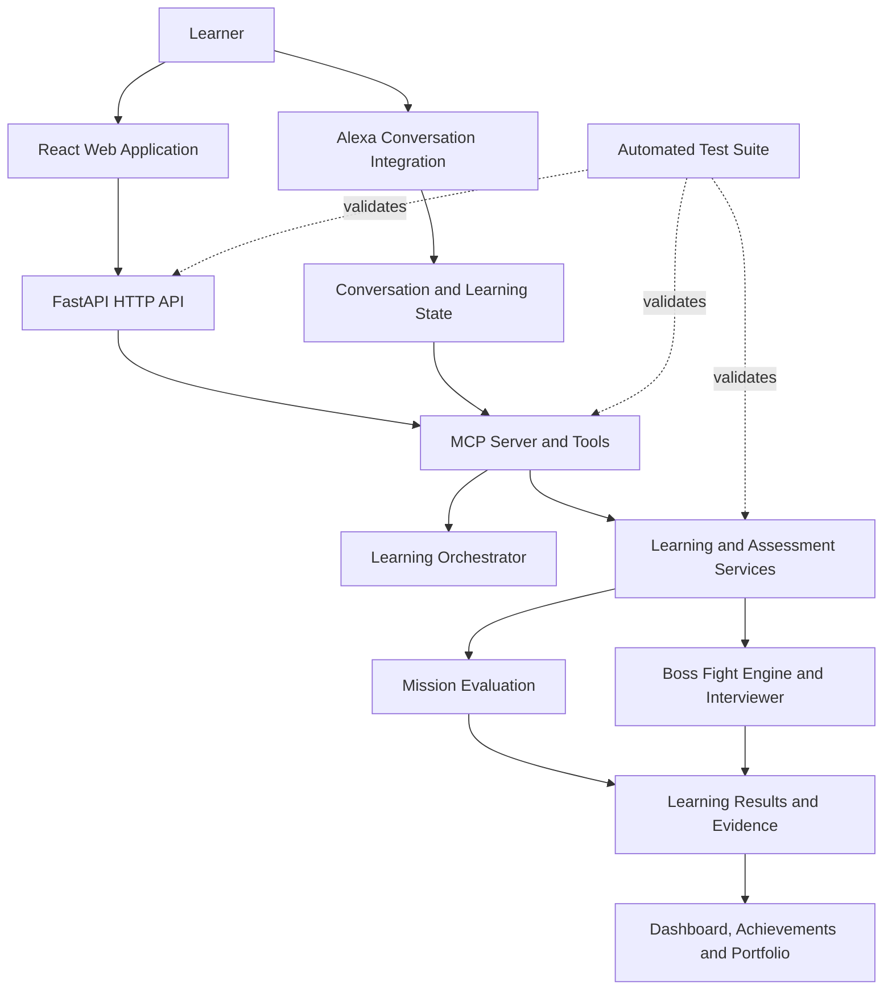

# Master It By Doing

**Learn. Build. Prove. Advance.**

Master It By Doing is an action-first, adaptive AI learning platform that helps learners turn goals into practical work, demonstrate skills through evidence, and progress toward mastery.

Instead of relying on passive lessons or self-reported completion, the platform guides learners through practical missions, evaluates their submissions, identifies demonstrated and missing skills, and adapts subsequent challenges. Learners can build portfolio evidence as they progress.

## The Learning Experience

**GOAL → ASSESS → MISSION → DO → EVALUATE → ADAPT → MASTER → ADVANCE**

1. **Goal** — establish the skill or outcome the learner wants to achieve.
2. **Assess** — establish a starting point and identify the appropriate learning challenge.
3. **Mission** — receive a practical, skill-oriented task.
4. **Do** — work through the task and submit an attempt.
5. **Evaluate** — assess the submitted work using applicable validation and evaluation services.
6. **Adapt** — use the assessment evidence to inform the next learning step.
7. **Master** — demonstrate the required skills through practical performance.
8. **Advance** — build portfolio evidence and progress toward more advanced challenges.

## Core Features

- **Adaptive learning missions:** goal-driven practical tasks with learner-aware progression.
- **Evidence-based assessment:** evaluate actual submissions rather than relying only on self-reported completion.
- **Deterministic validation:** apply objective checks where supported, including Python-specific validation.
- **AI-assisted evaluation:** use configured AI assessment services to interpret learner work.
- **Ground Truth validation:** reconcile objective criteria with assessment results where applicable.
- **Adaptive follow-up challenges:** use demonstrated performance to guide subsequent missions.
- **Skill-scoped learner state:** keep progress and learning evidence associated with the relevant learner and skill.
- **BOSS FIGHT mastery challenges:** challenge learners to explain, defend, and demonstrate their understanding beyond ordinary mission completion.
- **Portfolio evidence:** collect mission and Boss Fight results that demonstrate practical progress.
- **Achievement badges:** surface learning achievements in the learner experience.
- **Web and Alexa-oriented experiences:** support a React web interface and an Alexa conversation integration.

## BOSS FIGHT: Mission-Linked Mastery Challenges

**BOSS FIGHT** is a distinct mastery-assessment experience within Master It By Doing. It complements the normal mission lifecycle rather than replacing it.

A regular mission asks the learner to complete practical work. A Boss Fight raises the bar: the learner must respond to a focused challenge and, where the interview flow applies, answer follow-up questions that probe understanding.

### Boss Fight lifecycle

1. **Create** — create a challenge associated with the learner's learning context.
2. **Start** — begin the challenge and establish its active state.
3. **Interview** — continue a multi-turn assessment conversation, retaining the challenge's response context and transcript.
4. **Submit and evaluate** — assess the learner's response against the challenge requirements.
5. **Record the outcome** — track the challenge status and preserve its result.
6. **Build evidence** — make eligible Boss Fight outcomes available to the portfolio and achievement experience.

The implementation supports learner-scoped challenge states including `ready`, `in_progress`, `passed`, and `failed`.

### Separate assessment state

Boss Fight has dedicated engine, interviewer, API, MCP, and Alexa integration code, with separate challenge state and evaluation evidence. It is deliberately kept separate from ordinary mission evaluation so a Boss Fight attempt does not overwrite the normal mission assessment lifecycle.

Relevant implementation areas include:

- `services/assessment/boss_fight_engine.py`
- `services/assessment/boss_fight_interviewer.py`
- `api/main.py`
- `mcp-server/mcp_server/server.py`
- `alexa/conversation.py`
- `apps/web/src/pages/Mission.tsx`
- `apps/web/src/pages/Dashboard.tsx`

### Boss Fight API

The FastAPI application exposes the following challenge operations:

| Method | Endpoint | Purpose |
| --- | --- | --- |
| `POST` | `/api/boss-fights` | Create a challenge |
| `POST` | `/api/boss-fights/{challenge_id}/start` | Start a challenge |
| `POST` | `/api/boss-fights/{challenge_id}/interview` | Continue the interview |
| `POST` | `/api/boss-fights/{challenge_id}/evaluate` | Evaluate the challenge |
| `GET` | `/api/boss-fights/{challenge_id}` | Retrieve a challenge |
| `GET` | `/api/boss-fights` | List challenges |

These are application endpoints; successful execution depends on the required backend services and configuration being available.

## Assessment Architecture

The assessment pipeline separates AI-assisted reasoning from authoritative checks when objective validation is available.

**Learner Submission → Applicable Deterministic Validation → AI-Assisted Evaluation → Ground Truth Checks → Evidence-Based Result → Learning Adaptation**

The exact checks depend on the mission and the validators supported for that skill.

- Deterministic validators check objective requirements where available.
- AI-assisted evaluation interprets work that requires contextual reasoning.
- Ground Truth checks help validate objective assessment criteria where configured.
- Assessment evidence informs progression and subsequent learning challenges.

The purpose of this design is to avoid relying on an AI judgment alone when a reliable, objective check is available.

## Learning Paths and Progress

The application includes learning paths for:

- Python Programming
- AWS Cloud Computing
- JavaScript Development

Learning progress and evidence should remain scoped to the relevant learner and skill. Completing work in one learning path should not automatically be treated as mastery in another.

The platform's progression model connects practical missions, assessment results, Boss Fight outcomes, achievements, and portfolio evidence into a coherent learning journey.

## Architecture

The repository is organized into application, orchestration, service, and testing layers.



### Main components

| Component | Location | Responsibility |
| --- | --- | --- |
| Web application | `apps/web/` | React and TypeScript user interface, learning missions, Boss Fight interactions, dashboard and portfolio |
| HTTP API | `api/main.py` | FastAPI endpoints for learning state, missions, profiles and Boss Fight challenges |
| Agent orchestration | `agent/orchestrator.py` | Learning orchestration and coordination |
| MCP server | `mcp-server/mcp_server/server.py` | Tool interface between application workflows and learning services |
| Assessment services | `services/assessment/` | Mission evaluation and Boss Fight assessment logic |
| Alexa integration | `alexa/` | Conversation-oriented learning workflows and Boss Fight interactions |
| Automated tests | `tests/` | Regression, API, assessment, lifecycle, MCP and integration tests |

## Technology Stack

- **Language and backend:** Python 3.13, FastAPI
- **Frontend:** React 19, TypeScript, Vite
- **Tool integration:** Model Context Protocol (MCP)
- **AI and agent ecosystem:** Amazon Bedrock, AWS Bedrock AgentCore and Strands Agents, where configured
- **Voice and conversation:** Alexa integration
- **Quality assurance:** pytest and automated regression tests

Cloud services and AI integrations may require credentials, model access, environment variables, and service-specific configuration. Listing a technology here does not imply that every integration is deployed or enabled in every local environment.

## Repository Layout

```text
master-it-by-doing/
├── agent/                 # Learning orchestration
├── alexa/                 # Alexa conversation integration
├── api/                   # FastAPI application
├── apps/
│   └── web/               # React and TypeScript frontend
├── content/               # Learning content
├── docs/                  # Project documentation
├── infrastructure/        # Infrastructure-related resources
├── mcp-server/
│   └── mcp_server/        # MCP server and tools
├── services/              # Learning and assessment services
└── tests/                 # Automated test suite
```

## Local Development

### Prerequisites

- Python 3.13.x
- Node.js and npm
- The project's Python dependencies
- Any credentials or configuration required for the AI and cloud integrations you intend to use

The Python project currently declares a Python version range of `>=3.13,<3.14`. Use Python 3.13 for the supported development environment.

### Start the web application

From the repository root:

```powershell
Set-Location .\apps\web
npm install
npm run dev
```

Vite prints the local development URL in the terminal.

### Start the FastAPI application

From the repository root, with the project's virtual environment activated and its API dependencies installed:

```powershell
Set-Location "C:\Users\Darchums\Projects\master-it-by-doing"
python -m uvicorn api.main:app --reload --port 8001
```

The health endpoint is available at:

```text
http://127.0.0.1:8001/health
```

### Start the MCP server

Run the MCP server in a separate terminal. The repository root and the MCP server directory must be importable by Python:

```powershell
Set-Location "C:\Users\Darchums\Projects\master-it-by-doing"

$env:PYTHONPATH = "$PWD;$PWD\mcp-server"
python .\mcp-server\mcp_server\server.py
```

The API, MCP server, and frontend must be configured to communicate with the appropriate local service addresses. If the application fails to connect, check the service logs and the current environment configuration before changing application logic.

## Testing

Run the repository's Python test suite from the project root with the virtual environment activated:

```powershell
Set-Location "C:\Users\Darchums\Projects\master-it-by-doing"
python -m pytest
```

The suite includes coverage for assessment services, the Boss Fight engine and interviewer, Boss Fight API and MCP workflows, Alexa integration, and practice lifecycle behavior.

**Last recorded full-suite result: 143 tests passed** (verified October 17, 2026).

Re-run the suite after code changes to verify the current working tree; the recorded result is not a guarantee that subsequent changes still pass.

## Project Status

Master It By Doing is under active development. Its architecture combines adaptive practical learning with a distinct Boss Fight mastery-assessment lifecycle and learner portfolio evidence.

Future work can continue to improve the learner experience, assessment reliability, skill-path isolation, achievement presentation, and integration reliability.

## Product Principle

**Learn. Build. Prove. Advance.**

Learning should lead to practical work. Practical work should produce evidence. Evidence should guide the next challenge.
